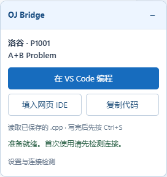
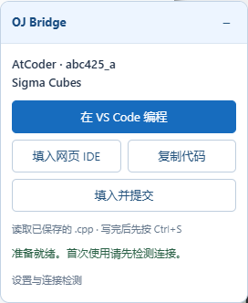

# 验证报告

验证日期：2026-10-15。运行环境：Windows、Edge、全局 Python 3.12.10、MSYS2 g++ 16.1.0。

## 自动化结果

| 检查 | 结果 | 范围 |
|---|---|---|
| Python unittest | 25/25 通过 | 建文件、题头/模板、重复打开不覆盖、同名避让、并发打开、配置持久化、UTF-8/BOM、路径边界、真实 framed stdio、默认/重定向文档目录、安装升级和 PowerShell 5.1 bootstrap |
| Node 核心测试 | 13/13 通过 | 7 类平台和 CF Gym/题库链接的身份、规范化、伪装域名/非 HTTPS 拒绝、提交页对应、题名与限制提取 |
| Edge 集成测试 | 17/17 通过（包含主测试和 16 项子检查） | 真实扩展 service worker、真实 Native Messaging 和 Windows launcher、设置读写、题目工具条、跨页面填入、编辑器、提交前核对、既有编译配置 |
| ZIP 完整性 | 打包脚本会检查必需文件、CRC、固定扩展 ID，排除配置及运行缓存 | 交付 ZIP 可独立解压，源码和安装文件齐全 |

Edge 测试使用独立临时 profile，不读取用户浏览器账号或 Cookie。测试期间注册的 Native Messaging 路径已在测试结束后恢复；之后另行完成本机正式连接程序的安装和诊断。

1.0.0 正式安装到 `%LOCALAPPDATA%\OJBridge` 后，以独立 Edge profile 验证了真实原生连接、已配置的源码目录和 VS Code 路径检测。安装扩展文件与交付源码的 SHA-256 逐一比对一致。日常浏览器 profile 仍需手动加载一次扩展。

### 已跑通的集成路径

- 扩展选项页通过真正的浏览器 Native Messaging 读写本地配置。
- 从题目页面创建正确的 `.cpp`，附题号和初始模板；重复打开不覆盖已保存代码。
- 原生启动的 GUI 进程在 Native Messaging 请求结束后继续运行，并收到正确的工作区、中文/空格文件路径和 `--goto` 参数。此项使用无害的 Code.exe 记录器替身，避免切换用户当前 VS Code 窗口；未自动操作真实 VS Code GUI。
- 洛谷样式页面的 hash 跳转后自动回填；修复了 Edge MessageSender.url 在 hash/SPA 跳转后可能保留旧地址的问题。
- AtCoder 样式页面从题目页进入提交页，选择正确题号、C++20，填入源码并点击模拟提交按钮一次。
- 曙梦/Hydro 样式页面按上游真实模板的“无 action 原生 form + lang select + code textarea”完成同样的模拟流程。
- textarea、Monaco、Ace、CodeMirror 5、可访问 EditorView 的 CodeMirror 6 均通过填入和回读检查。多个 Monaco 模型、无语言选项、无题号选项、无唯一编辑器时停止直接提交并提示后续操作。
- 对新建源码执行 VS Code 编译任务，生成程序位于 `${workspaceFolder}\exe`，运行输出 `42`，源码目录没有散落的 exe。1.1.0 的集成测试使用仓库内通用的 `examples/vscode/tasks.json`，不依赖开发者本机配置。

## 真实站点检查

| 站点 | 当前公开页面结果 | 登录后填入/真实提交 |
|---|---|---|
| [洛谷 P1001](https://www.luogu.com.cn/problem/P1001) | Edge 实际加载通过，工具条显示正确；题名 A+B Problem、时限 1.00s、内存 512.00MB | 未验证登录后网页编辑器；不提供自动点击提交 |
| [AtCoder abc425_a](https://atcoder.jp/contests/abc425/tasks/abc425_a) | Edge 实际加载通过，工具条显示正确；题名 Sigma Cubes、时限 2 sec、内存 1024 MiB；已剔除标题里的 Editorial 按钮文字 | 提交页会转到登录页，未使用用户账号；真实提交未验证 |
| [曙梦示例题](https://oj.shumeng.tech/p/CSP202609B) | 本次 HTTPS/浏览器连接均失败，Edge 报 net::ERR_CONNECTION_CLOSED | 未完成当前真实页面验证；只验证 URL、本地能力与 Hydro 样本 |
| Codeforces、牛客、LibreOJ、Hydro 其他实例 | URL 和本地身份规则通过自动化；未完成各自当前真实页面验证 | 未验证 |

Hydro 页面适配参考了当前上游的 [problem_submit.html](https://github.com/hydro-dev/Hydro/blob/master/packages/ui-default/templates/problem_submit.html) 和 [problem_submit.page.tsx](https://github.com/hydro-dev/Hydro/blob/master/packages/ui-default/pages/problem_submit.page.tsx)。实际曙梦可能有定制或版本差异，不能据此声称当前站点端到端提交成功。

所有自动提交检查都在本地拦截的模拟页面中完成，没有向真实 OJ 发送任何代码或测试提交。

Chrome 的注册和通用 MV3 文件已提供，但未运行 Chrome 实机验证。某些站点封装的编辑器不可直接访问时，需要使用复制入口。浏览器内加载扩展、登录、验证码和平台自身的评测结果仍由用户在网页完成。

## 1.1.0 可移植性检查

新增默认文档路径解析、重定向文档目录、旧设置保留、自定义安装/源码目录、便携版 VS Code 路径及错误参数测试。具体本地和 GitHub Actions 测试结果见本次发布的 CI 与 Release 说明。示例、测试和源码不再写死个人用户名、固定源码盘符或编译器安装目录。

1.1.0 本地回归结果为 Python 25/25、Node 13/13、Edge 17/17。Edge 集成中的 C++ 编译来自通用示例任务，Python/Edge/编译器通过自动检测或环境变量指定。另修复了没有待恢复操作时的后台检查短暂占用用户操作锁的问题。

## 界面截图

以下是本次真实公开题目页中工具条的实际截图：

## 1.2.0 力扣支持验证（2026-10-16）

本地 Python 30/30、Node 20/20、Edge 20/20。新增检查包括中英文站及比赛/题库身份统一、设计题官方类名、缺失/超长/不匹配模板、离线重开不覆盖、SPA 切题后身份核对、其他语言拒绝回填和多编辑器隔离。Edge 样本通过真实 Native Messaging 创建文件、读取保存内容并回填；模板接口在样本测试中模拟，不执行真实提交。

另用隔离的 Edge profile 和实际扩展检查当前公开站点：

- [力扣中文站两数之和](https://leetcode.cn/problems/two-sum/description/)：工具条出现，官方题号 1、中文题名和 C++ 模板读取通过；MAIN world 使用真实 Monaco 的 executeEdits 完成填入及回读。仅 C++ 模型变化，plaintext 测试用例模型未变化。
- [LeetCode 国际站两数之和](https://leetcode.com/problems/two-sum/description/)：扩展后台读取官方英文题名、题号和 C++ 模板通过；本次浏览器页面出现站点验证，未验证国际站真实编辑器填入。
- 模板请求使用 credentials: omit，不读取用户账号/Cookie；没有登录用户账号，没有点击真实运行或提交按钮。

力扣使用函数/类判题，因此模板不带 main()，本地直接运行需要自行增加测试入口。当前版本提供填入/复制，提交由用户点击网页按钮。
